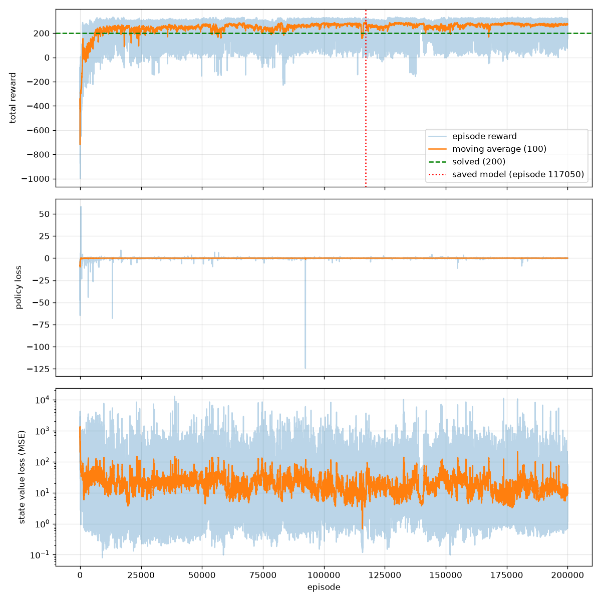

# 🚀 Actor-Critic without PyTorch

> **PyTorch 없이, NumPy만으로** 처음부터 끝까지 구현한 Actor-Critic 에이전트로
> Gymnasium `LunarLander-v3`를 **풀었습니다.** (100판 평균 **289점**, 기준 200점)


-2EA44F)

<p align="center">
  
</p>

### 📒 공부 노트

- [Actor-Critic 노트](https://learnupsmartnote.com/workspace/shared?code=52c6ac10b68c)
- [Adam 노트](https://learnupsmartnote.com/workspace/shared?code=da95d9caebd5)

---

## 🏆 이뤄낸 것

| | |
|---|---|
| 📐 | **모든 수식과 수학적 원리를 이해하고 구현** — TD error, 정책 기울기, 역전파, Adam, 엔트로피 기울기까지 직접 유도 |
| 🧮 | **PyTorch 없이 NumPy로만 구현** — 자동 미분(autograd) 없이 모든 기울기를 손으로 계산 |
| 🧠 | **확률적 정책 신경망 + 가치 함수 신경망** — 두 MLP의 forward / backward 전부 NumPy로 구현 |
| ⚙️ | **Adam optimizer를 NumPy로만 구현** — 1·2차 모멘트, 편향 보정까지 (교과서 구현과 오차 1e-16) |
| 🎲 | **Entropy bonus를 NumPy로만 구현** — 엔트로피의 로짓 기울기를 직접 유도해 softmax backward에 추가 |
| 📉 | **에피소드 기반 선형 학습률 스케줄을 NumPy로만 구현** |
| 🔧 | **하이퍼파라미터 튜닝 & 디버깅** — 학습이 왜 안 되는지 원인을 찾아 하나씩 해결 ([디버깅 여정](#-디버깅-여정)) |
| ✍️ | **RL 핵심 코드는 AI 코드 & 인터넷 코드 없이 전부 직접 작성** ([작성 범위](#-코드-작성-범위)) |

---

## 📊 결과

<p align="center">
  
</p>

**최종 모델** (`models/ai_model_2026-11-11_16-51-04.json`, 학습 중 100판 평균이 가장 높았던 117,050번째 에피소드 시점)

| 평가 방식 (처음 보는 100판) | 평균 점수 | 표준편차 | 착륙 성공 (200점 이상) |
|---|---|---|---|
| Greedy (argmax) | **284.1** | 29.2 | **99 / 100** |
| Sampling (확률대로) | **282.5** | 38.4 | **98 / 100** |

- 100판 평균이 처음 **200점을 넘은 시점: 6,079번째 에피소드**
- 학습 중 최고 100판 평균: **289.0점**

---

## 🧩 알고리즘

**One-step batch Actor-Critic** (+ entropy bonus, Adam, 선형 학습률 스케줄)

**TD target / TD error** — 게임이 끝나면(`terminated`) 다음 상태 가치를 0으로, 시간 초과(`truncated`)는 계속 bootstrap

$$y_t = r_t + \gamma \, V_w(s_{t+1}) \, (1 - \text{done}_t), \qquad \delta_t = y_t - V_w(s_t)$$

**Actor (정책 신경망) loss** — 정책 기울기 + 엔트로피 보너스

$$L_\pi = -\frac{1}{N}\sum_t \Big[ \delta_t \log \pi_\theta(a_t \mid s_t) + \beta \, H\big(\pi_\theta(\cdot \mid s_t)\big) \Big], \qquad H(\pi) = -\sum_a \pi(a)\log \pi(a)$$

로짓 $z$에 대한 기울기 (softmax backward에 직접 구현):

$$\frac{\partial L_\pi}{\partial z_i} = \frac{1}{N}\Big[\delta_t\,(\pi_i - \mathbb{1}[i=a_t]) + \beta\,\pi_i\,(\log \pi_i + H)\Big]$$

**Critic (가치 함수 신경망) loss** — semi-gradient TD(0), target은 상수 취급

$$L_V = \frac{1}{N}\sum_t \big(V_w(s_t) - y_t\big)^2, \qquad \frac{\partial L_V}{\partial V} = \frac{2}{N}\big(V_w(s_t) - y_t\big) = -\frac{2}{N}\delta_t$$

**Adam**

$$m_t = \beta_1 m_{t-1} + (1-\beta_1) g_t, \quad v_t = \beta_2 v_{t-1} + (1-\beta_2) g_t^2$$

$$\hat m_t = \frac{m_t}{1-\beta_1^t}, \quad \hat v_t = \frac{v_t}{1-\beta_2^t}, \quad \theta_{t+1} = \theta_t - \eta \frac{\hat m_t}{\sqrt{\hat v_t} + \epsilon}$$

**선형 학습률 스케줄**

$$\eta_{\text{episode}} = \eta_{\text{initial}} - (\eta_{\text{initial}} - \eta_{\text{final}}) \cdot \frac{\text{episode}}{\text{total episodes}}$$

---

## ⚙️ 하이퍼파라미터

| 항목 | 값 |
|---|---|
| 신경망 구조 | Actor `8 → 128 → 64 → 4` (softmax) / Critic `8 → 128 → 64 → 1` (linear), ReLU, He 초기화 |
| Discount factor γ | 0.99 |
| Optimizer | Adam (β₁ = 0.9, β₂ = 0.999, ε = 1e-8) |
| Actor learning rate | 3e-4 → 3e-5 (선형 감소) |
| Critic learning rate | 1e-3 → 1e-4 (선형 감소) |
| Entropy coefficient β | 0.05 |
| Batch size | 64 step (에피소드가 끝나면 남은 step으로도 업데이트) |
| 총 에피소드 | 200,000 |

---

## 🔍 디버깅 여정

코드가 수식대로 동작하는지 먼저 확인한 뒤(역전파 수치 미분 검증), 학습이 막힐 때마다 **원인을 데이터로 찾아서** 해결했습니다.

| 증상 | 원인 | 해결 |
|---|---|---|
| 1만 판을 돌려도 학습이 매우 느림 | `BATCH_SIZE = 1024` > 에피소드 최대 길이 1000 → **에피소드당 업데이트 1번** | batch 256 → 64 |
| 착지는 하는데 1000스텝까지 안 끝남 | 땅에서 좌우 엔진을 계속 쏴서 몸체가 멈추지 않음 → +100 보너스를 못 받음 (**NOOP 확률 0.02로 붕괴**) | **Entropy bonus** 추가 |
| 학습 중 갑자기 성능 폭락 | SGD + 작은 batch → Critic 폭주 → 거대한 δ가 Actor를 한 번에 밀어버림 | **SGD → Adam** |
| 엔트로피를 줄였더니 오히려 악화 | 함정을 탈출하기 전에 엔트로피가 너무 빨리 작아짐 | 엔트로피 0.05 고정 유지 |
| 정점을 찍은 뒤 "공중에 떠 있기"로 퇴보 | Critic lr(1e-4)이 Actor lr(3e-4)보다 느려서 V가 정책 변화를 못 따라감 | Critic lr 1e-3으로 상향 |
| 좋아졌다 나빠졌다 반복 | 후반에도 step이 커서 배운 정책이 흔들림 | **선형 학습률 감소** + **최고 평균 시점 모델 저장** |
| 학습 점수는 높은데 greedy 시연은 실패 | 덜 수렴한 확률적 정책을 argmax하면 학습 때와 다른 정책이 됨 | 샘플링/greedy 둘 다 평가 (충분히 학습된 최종 모델은 둘 다 성공) |

---

## 📁 구조

```
├── learning.py                     # 학습 루프 (batch TD, 로그, 그래프, 최고 모델 저장)
├── model.py                        # Agent: TD target / TD error 계산, Actor·Critic 업데이트
├── poilcy_neural_network.py        # Actor: 확률적 정책 신경망 (softmax)
├── state_value_neural_network.py   # Critic: 상태 가치 함수 신경망
├── Adam.py                         # Adam optimizer
├── batch.py                        # 경험 batch (s, a, r, s', terminated)
├── config.py                       # 에피소드 수, batch 크기
├── MLP/                            # NumPy MLP (Affine, ReLU, SoftmaxWithLoss + entropy, MSE)
├── simulate.py                     # 학습된 모델 시연 (IS_GREEDY로 greedy / sampling 선택)
├── review.py                       # 학습 중 에피소드 재생 (seed + 행동 기록으로 그대로 재현)
└── models/                         # 모델(json), 학습 그래프(png), review log(json)
```

---

## ▶️ 실행 방법

```bash
pip install -r requirements.txt
```

```bash
python learning.py   # 학습 (Ctrl+C로 중간에 꺼도 저장됨)
python simulate.py   # 가장 최근 모델 시연
python review.py     # 학습 중 최고 점수 에피소드 재생 (python review.py 9999 / best / worst / last)
```

---

## ✍️ 코드 작성 범위

**직접 작성 (AI 코드 & 인터넷 코드 사용 안 함)**
- Actor-Critic 핵심 로직: TD target / TD error, terminated·truncated 처리, batch 업데이트 (`model.py`, `batch.py`, `learning.py`의 학습 루프)
- 정책 신경망, 가치 함수 신경망과 역전파 (`poilcy_neural_network.py`, `state_value_neural_network.py`, `MLP/`)
  - MLP는 예전에 직접 짜둔 코드를 가져와서 사용
- Adam, entropy bonus, 선형 학습률 스케줄

**AI 도움을 받은 부분 (학습 보조 도구)**
- `simulate.py`, `review.py`
- `learning.py`의 저장 관련 코드 (모델·review log 저장, 최고 평균 모델 저장), 학습 기록용 그래프 (matplotlib)

---

## 🔜 Next

**PPO를 NumPy로 구현하기** — 이번에 겪은 "정점을 찍고 정책이 무너지는" 문제가 바로 PPO가 정책 변화량을 clipping으로 제한하는 이유. 더 복잡한 게임 환경에서, 이미지가 아닌 게임 메모리 값을 관측으로 사용할 예정.
